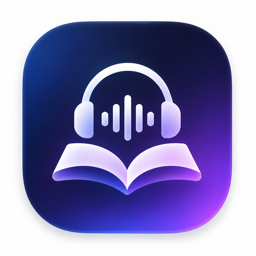
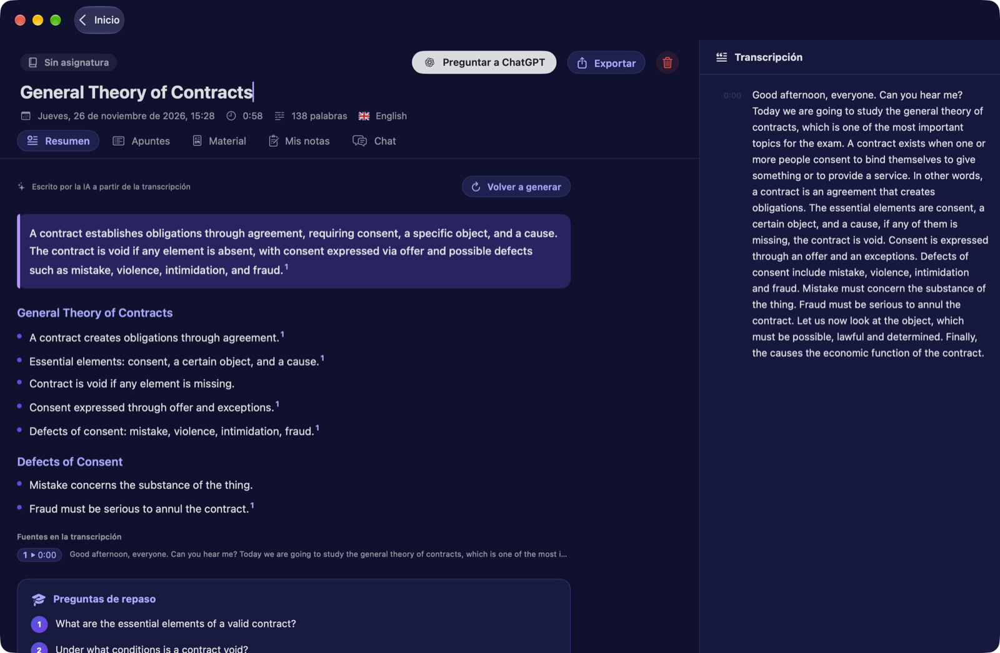
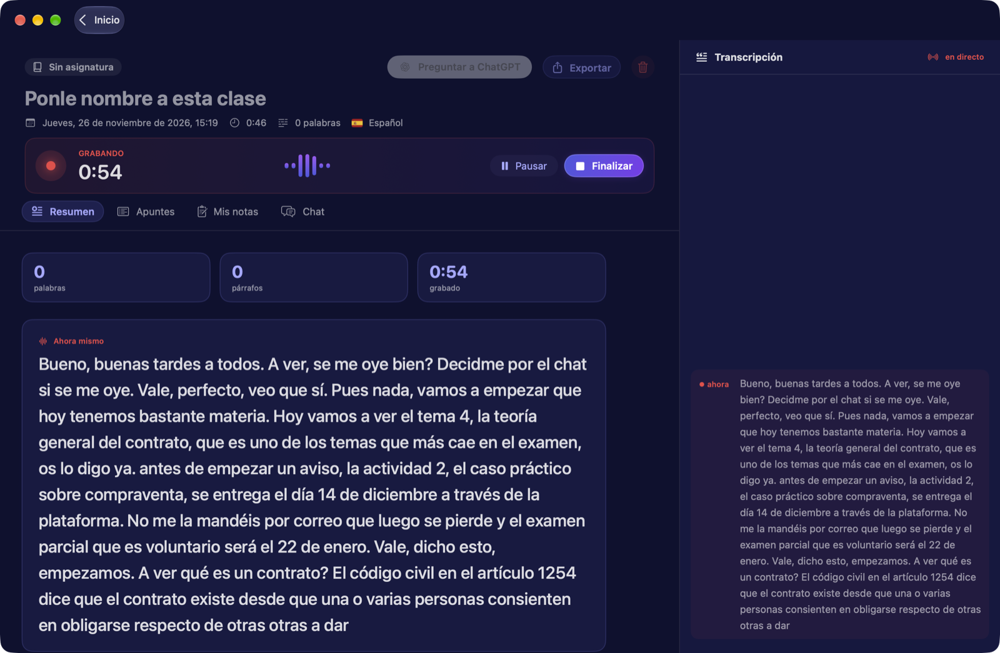
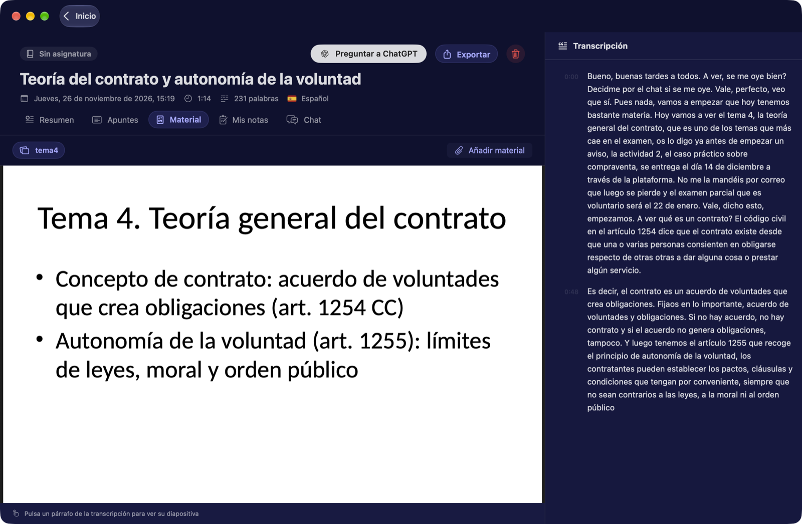

<p align="center">
  
</p>

<h1 align="center">EstudIA</h1>

<p align="center">
  Graba las clases que ves en el Mac, las transcribe al momento y te deja el resumen, los apuntes y las preguntas de repaso.<br>
  Todo en tu ordenador: el audio no sale de él.
</p>

<p align="center">
  
  
  
</p>

<p align="center">
  
</p>

## Qué hace

| | |
|---|---|
| **Graba solo el sonido del Mac** | Clases en el navegador, vídeos o Zoom. El micrófono queda fuera. |
| **Transcribe en directo** | Párrafos legibles con su minuto, y detecta sola si la clase es en español o en inglés. |
| **Resumen al grano** | Idea central, un apartado por tema y «Para recordar» con fechas, entregas y avisos de examen. Cada punto enlaza con el momento de la clase del que sale. «Volver a generar» lo rehace cuando quieras. |
| **Apuntes y preguntas de repaso** | Generados con el modelo de Apple en el propio Mac. Opcional: un modelo en la nube (Groq u otro compatible con OpenAI) con tu clave. |
| **Material de la clase** | Añade el PDF o el PowerPoint del profesor: se usa en los apuntes y, al leer la transcripción, salta sola a la diapositiva de la que se habla. |
| **Avisa cuando empieza una clase** | Al entrar en una reunión de Zoom o poner un vídeo de clase, la píldora pregunta «¿Grabar esta clase?». Nunca graba sola. |
| **Píldora y barra de menús** | Una cápsula flotante con ondas que siguen al sonido, y el icono de arriba para grabar, pausar y abrir las últimas clases. |
| **Se actualiza sola** | Con Sparkle desde las releases de este repositorio. Las clases no se tocan y se guarda una copia antes de cada versión nueva. |

<table>
  <tr>
    <td width="50%"></td>
    <td width="50%"></td>
  </tr>
  <tr>
    <td align="center"><sub>Grabando: lo que se dice ahora mismo, en grande</sub></td>
    <td align="center"><sub>El material de la clase, en la diapositiva de la que se habla</sub></td>
  </tr>
</table>

<p align="center">
  
  
  <br>
</p>

## Instalar

1. Descarga `EstudIA-x.y.dmg` de la [última release](https://github.com/diegoperezg7/EstudIA/releases/latest).
2. Arrastra EstudIA a Aplicaciones y ábrela.
3. Concede «Grabación de pantalla y audio del sistema» cuando lo pida y reinicia la app desde el aviso.

Requisitos: macOS 26 o posterior en Apple Silicon, con Apple Intelligence activado para los resúmenes.

## Privacidad

- El audio y la transcripción se procesan en el Mac (SpeechAnalyzer y el modelo de Apple).
- Solo si configuras un proveedor en la nube, el texto de la clase se envía a ese proveedor para escribir los apuntes. La clave se guarda en el Llavero.
- La biblioteca vive en `~/Library/Application Support/StudyAI/`, fuera de la app.

## Desarrollo

### Compilar y abrir

```bash
scripts/build-app.sh          # build/EstudIA.app, firmada con Developer ID si está, si no con Apple Development
open build/EstudIA.app
swift test                    # pruebas de la lógica sin hardware
swift scripts/make-icon.swift # regenera el icono
scripts/make-dmg.sh           # build/EstudIA.dmg con el fondo de Resources/dmg (arrastrar a Aplicaciones)
```

La primera vez, macOS pide el permiso «Grabación de pantalla y audio del sistema». Tras concederlo hay que
reiniciar la app (el onboarding tiene un botón para ello).

### Importar una grabación

Si la clase se puede descargar, se arrastra el audio o vídeo a la lista o se usa «Importar» (⌘I).
Pasa por el mismo reconocedor y la misma IA que la grabación en directo.

### Autopruebas del pipeline real

```bash
APP=build/EstudIA.app/Contents/MacOS/StudyAI
$APP --selftest-transcribe clase.m4a      # fichero → mismo camino que la captura → segmentos
$APP --selftest-ai transcripcion.txt      # apuntes, resumen y preguntas
$APP --selftest-speaker captura.png        # quién habla según la pantalla (macOS 27)
$APP --selftest-chat transcripcion.txt "Añade al resumen un ejemplo"   # chat y su acción
$APP --selftest-language clase.m4a        # qué idioma detecta
$APP --selftest-detector                  # qué apps suenan y qué clase se ofrecería
$APP --selftest-transcribe class.aiff en   # en inglés (también --selftest-ai ... en)
open -n build/EstudIA.app --args --selftest-capture /tmp/cap.wav 10   # audio del sistema → WAV (+ .log)

# La app completa, sin pulsar nada:
open build/EstudIA.app --args --import clase.m4a       # importa y procesa
open build/EstudIA.app --args --record-for 40          # graba de verdad 40 s y finaliza sola
open build/EstudIA.app --args --record-for 90 --script "pause@15,resume@25,drop@40,crash@60"
                                                       # pausa, corte de captura simulado y cierre en seco
open build/EstudIA.app --args --lang en --import class.m4a   # clase en inglés
open build/EstudIA.app --args --open-latest            # abre la última clase
open build/EstudIA.app --args --fake-class "UNIR · Tema 5"   # simula una clase sonando: la píldora propone grabarla
open --env STUDYAI_NO_VISION=1 build/EstudIA.app ...   # sin detectar quién habla (para medir consumo)
open build/EstudIA.app --args --dark                   # fuerza el modo oscuro
```

### Estructura

- `Sources/StudyAICore`: troceado, búsqueda, conversión y remuestreo de audio, exportación a Markdown. Con pruebas.
- `Sources/StudyAI/Capture`: ScreenCaptureKit, permisos y el aviso de clase (Zoom y vídeos en el navegador).
- `Sources/StudyAI/Transcription`: SpeechAnalyzer en streaming.
- `Sources/StudyAI/AI`: map-reduce sobre el modelo de Apple (ventana de 8k tokens) y cliente opcional compatible con OpenAI.
- `Sources/StudyAI/Session`: estado de la grabación, reconexión, persistencia por segmentos y procesado en segundo plano.
- `Sources/StudyAI/UI`: píldora flotante, biblioteca, detalle de clase y onboarding.

El ejecutable y el identificador siguen siendo `StudyAI` / `es.personal.studyai` para conservar el permiso y los datos.
Los datos viven en `~/Library/Application Support/StudyAI/StudyAI.store`.

## Publicar una versión

Se hace desde el Mac que tiene el certificado Developer ID. Una vez:

```bash
xcrun notarytool store-credentials estudia --apple-id <tu-apple-id> --team-id <TEAMID>   # contraseña de app de appleid.apple.com
.build/artifacts/sparkle/Sparkle/bin/generate_keys          # clave EdDSA en el llavero; imprime la pública
.build/artifacts/sparkle/Sparkle/bin/generate_keys -p > Resources/sparkle-public-key.txt
gh auth login                                               # con la cuenta dueña del repo
```

Cada versión (con todo commiteado):

```bash
scripts/release.sh 1.2 notas.md
```

Compila, firma la app y Sparkle con Developer ID, crea y notariza el DMG, firma la actualización, genera
`appcast.xml` y crea la release `v1.2` con los dos ficheros. Las apps instaladas la encuentran en su comprobación diaria.

La clave privada de Sparkle no sale del llavero de ese Mac: sin ella no se pueden publicar actualizaciones
(`generate_keys -x fichero` para hacer una copia y guardarla a buen recaudo).
